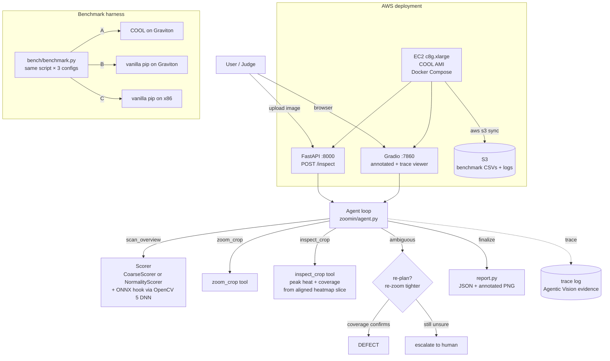

# Architecture

## Components

| Component | Runs where | OpenCV 5 usage | AWS usage |
|---|---|---|---|
| Agent loop + tools | EC2 container | morphology, contours, connected components | EC2 Graviton (COOL AMI) |
| CoarseScorer | EC2 container | medianBlur, boxFilter, GaussianBlur | — |
| NormalityScorer | EC2 container | resize, abs-diff, GaussianBlur | — |
| inspect_crop | EC2 container | threshold, findContours | — |
| FastAPI / Gradio | EC2 container | imdecode/imencode | served from EC2 |
| Benchmark | EC2 (3 configs) | whole pipeline | Graviton vs x86, $/10K images |
| Artifacts | — | — | S3 bucket (`aws s3 sync` in the runbook, not in app code) |

The UI runs the agent in-process; it does not call the API over HTTP. Both
entry points share `load_default_scorer()` and `InspectorConfig.for_scorer()`,
so they cannot disagree about which scorer or thresholds are active.

## Data flow

1. Image lands via API upload or the UI (`POST /inspect` reads the upload as a
   plain `def`, so the CPU-bound loop runs in a worker thread rather than on
   the event loop).
2. `scan_overview` produces a heatmap; boxes are proposed from it.
3. The agent spends its crop budget: `zoom_crop` → `inspect_crop` → decide.
   Ambiguous regions trigger a tighter re-zoom (re-plan); the re-zoom's
   `coverage` decides between DEFECT and escalation.
4. `finalize_report` emits verdicts, the full tool trace, and an annotated image.
5. The trace is the Agentic Vision deliverable: it proves vision outputs changed
   later tool calls (heatmap → crop coordinates; coverage → confirm vs escalate).
