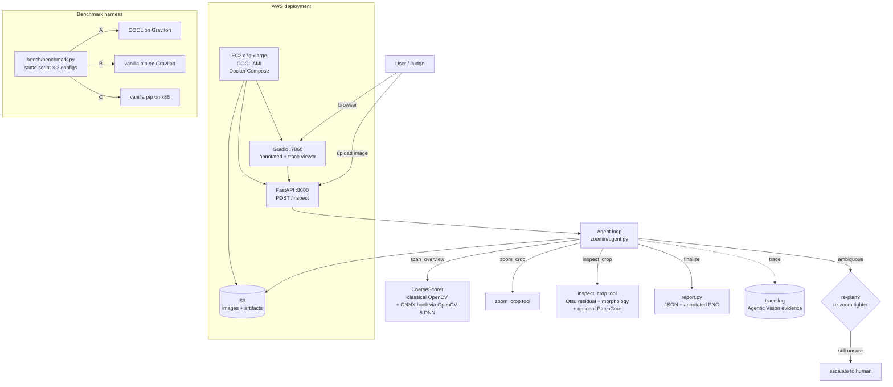

# Architecture

## Components

| Component | Runs where | OpenCV 5 usage | AWS usage |
|---|---|---|---|
| Agent loop + tools | EC2 container | DNN engine (ONNX hook), morphology, contours, connected components | EC2 Graviton (COOL AMI) |
| CoarseScorer | EC2 container | medianBlur, boxFilter, GaussianBlur | — |
| inspect_crop | EC2 container | Otsu threshold, morphologyEx, findContours | — |
| FastAPI / Gradio | EC2 container | imdecode/imencode | served from EC2, images in S3 |
| Benchmark | EC2 (3 configs) | whole pipeline | Graviton vs x86, $/10K images |
| Dataset | — | — | S3 bucket |

## Data flow

1. Image lands via API/UI (or S3 for batch benchmark).
2. `scan_overview` produces a heatmap; boxes are proposed from it.
3. The agent spends its crop budget: `zoom_crop` → `inspect_crop` → decide.
   Ambiguous regions trigger a tighter re-zoom (re-plan) or escalation.
4. `finalize_report` emits verdicts, the full tool trace, and an annotated image.
5. The trace is the Agentic Vision deliverable: it proves vision outputs changed
   later tool calls (heatmap → crop coordinates; score → re-zoom vs escalate).
